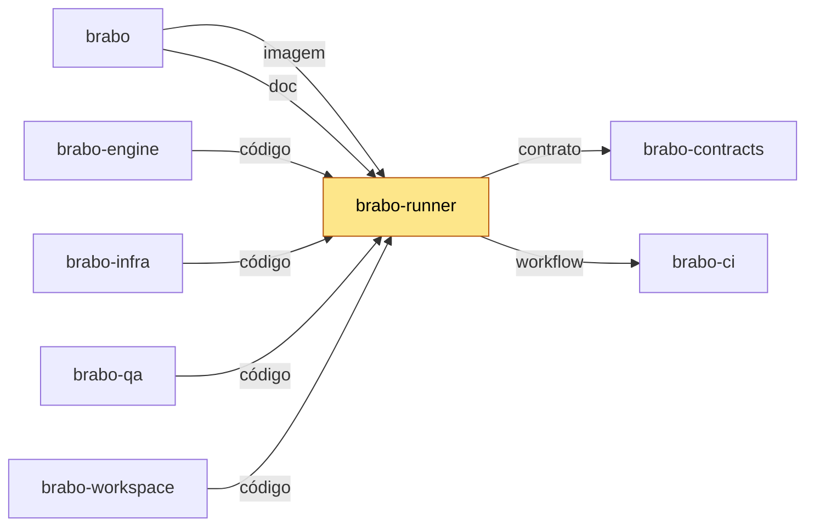

# brabo-runner

[](https://github.com/viralabs-dev/brabo-runner/actions/workflows/ci.yml?query=branch%3Adev)
[](https://github.com/viralabs-dev/brabo-runner/actions/workflows/ci.yml?query=branch%3Amain)
[](https://github.com/viralabs-dev/brabo-runner/tags)
[](https://github.com/viralabs-dev/brabo-runner/releases/latest)
[](LICENSE)
[](https://viralabs-dev.github.io/brabo/prd/)
[](https://ko-fi.com/daneiel)

CLI que roda na sua máquina e deixa o Brabo executar comandos, abrir terminais e subir containers sobre a pasta do seu código, sem que ela saia daí.

## Para que existe

Alguns projetos do Brabo ficam na máquina do usuário (modo `runner`), sem bind mount no servidor. Alguém precisa fazer, ali, o que os agentes pediram: rodar comandos já aprovados, abrir o terminal da aba **Terminal**, listar pastas para o seletor "Procurar pasta..." e subir o container do projeto. É este processo, separado do servidor porque precisa dos privilégios de quem o executa. Ele não decide política: só faz o que o produto já aprovou.

## Onde se encaixa

O runner conecta ao engine por um canal Phoenix autenticado com ticket de uso único. Quem muda o contrato do canal ou a porta de Docker mexe aqui também.

<!-- mapa:inicio -->
<!-- Gerado do repos.yml do brabo por brabo-ci:scripts/ci/mapa-dos-repos.ts. Não edite à mão. -->

**brabo-runner** — CLI `brabo-runner` na máquina do usuário — PTY, container local e espelho. Binário publicado por tag, instalado pelo brabo; o brabo-engine e o brabo-qa leem o código dele nos testes.

| repo | propósito | como é usado | depende de | é usado por |
|---|---|---|---|---|
| [brabo](https://github.com/viralabs-dev/brabo) | Porta de entrada do produto — documentação agregada, site, instalador e release. | Quem instala usa o `install.sh` e as imagens e o binário das tags de `componentes.json`; o brabo-infra o clona nas aferições cruzadas. | brabo-api (imagem, doc), brabo-engine (imagem, doc), brabo-web (imagem, doc), brabo-broker (imagem, doc), brabo-runner (imagem, doc), brabo-infra (imagem, código, doc), brabo-contracts (contrato, doc), brabo-ci (doc, workflow), brabo-qa (doc) | brabo-ci (contrato), brabo-infra (código), brabo-workspace (código) |
| [brabo-api](https://github.com/viralabs-dev/brabo-api) | API do produto (NestJS, Drizzle, PostgreSQL/pgvector) — schema, RBAC, LLM, metering e gates. | Imagem publicada por tag e consumida pelo brabo e pelo brabo-infra; o brabo-web, o brabo-engine e o brabo-qa leem o código ou o `openapi.json` dele. | brabo-contracts (contrato), brabo-infra (código), brabo-qa (workflow), brabo-ci (workflow) | brabo (imagem, doc), brabo-engine (código), brabo-web (contrato), brabo-contracts (contrato), brabo-infra (código), brabo-qa (código), brabo-workspace (código) |
| [brabo-engine](https://github.com/viralabs-dev/brabo-engine) | Engine (Elixir/OTP, Phoenix, Oban) — agentes, sessões, gates e roteamento de runners. | Imagem publicada por tag, usada pelo brabo e pelo brabo-infra. | brabo-contracts (contrato), brabo-api (código), brabo-runner (código), brabo-qa (workflow), brabo-ci (workflow) | brabo (imagem, doc), brabo-infra (código), brabo-qa (código), brabo-workspace (código) |
| [brabo-web](https://github.com/viralabs-dev/brabo-web) | Interface web (React 19, Vite) — telas, i18n e design system. | Imagem publicada por tag, usada pelo brabo e pelo brabo-infra. | brabo-contracts (contrato), brabo-api (contrato), brabo-qa (workflow), brabo-ci (workflow) | brabo (imagem, doc), brabo-infra (código), brabo-qa (código), brabo-workspace (código) |
| **brabo-runner** | CLI `brabo-runner` na máquina do usuário — PTY, container local e espelho. | Binário publicado por tag, instalado pelo brabo; o brabo-engine e o brabo-qa leem o código dele nos testes. | brabo-contracts (contrato), brabo-ci (workflow) | brabo (imagem, doc), brabo-engine (código), brabo-infra (código), brabo-qa (código), brabo-workspace (código) |
| [brabo-broker](https://github.com/viralabs-dev/brabo-broker) | Único processo com o socket do Docker do servidor. | Imagem publicada por tag, usada pelo brabo e pelo brabo-infra. | brabo-contracts (contrato), brabo-qa (workflow), brabo-ci (workflow) | brabo (imagem, doc), brabo-infra (código), brabo-qa (código), brabo-workspace (código) |
| [brabo-contracts](https://github.com/viralabs-dev/brabo-contracts) | Contratos compartilhados — os pacotes `shared` e `docker-port`, `areas.json` e `fluxo.yml`. | Consumido por TAG (pacote no GitHub Packages ou arquivo baixado por raw na mesma tag); uma tag nova pede bump em api, web, runner, broker, engine, qa e infra. | brabo-api (contrato), brabo-ci (workflow) | brabo (contrato, doc), brabo-api (contrato), brabo-engine (contrato), brabo-web (contrato), brabo-runner (contrato), brabo-broker (contrato), brabo-infra (código), brabo-qa (contrato), brabo-workspace (código) |
| [brabo-ci](https://github.com/viralabs-dev/brabo-ci) | Workflows reutilizáveis e a política de PR, escada de aprovação, promoção, tag e Dependabot. | Cada repo chama `uses: viralabs-dev/brabo-ci/...@<sha>`, fixado por SHA. | brabo-qa (contrato, workflow), brabo (contrato) | brabo (doc, workflow), brabo-api (workflow), brabo-engine (workflow), brabo-web (workflow), brabo-runner (workflow), brabo-broker (workflow), brabo-contracts (workflow), brabo-infra (workflow), brabo-qa (workflow), brabo-workspace (código, workflow) |
| [brabo-infra](https://github.com/viralabs-dev/brabo-infra) | Composes, Dockerfiles de integração, `deploy/k8s`, scripts de dev, release e cadeia de suprimentos. | O brabo clona o brabo-infra no ref de `componentes.json` para subir a instalação; o brabo-api e o brabo-qa o clonam no CI. | brabo-api (código), brabo-engine (código), brabo-web (código), brabo-broker (código), brabo-runner (código), brabo-contracts (código), brabo (código), brabo-qa (workflow), brabo-ci (workflow) | brabo (imagem, código, doc), brabo-api (código), brabo-qa (código), brabo-workspace (código) |
| [brabo-qa](https://github.com/viralabs-dev/brabo-qa) | E2E de navegador (Playwright), golden-sets e catálogo de funcionalidades — o portão da `main`. | O brabo-ci dispara o `e2e-pr` dele e lê o `funcionalidades.yml`; api, engine, web, broker e infra o chamam como portão. | brabo-api (código), brabo-engine (código), brabo-web (código), brabo-runner (código), brabo-broker (código), brabo-infra (código), brabo-contracts (contrato), brabo-ci (workflow) | brabo (doc), brabo-api (workflow), brabo-engine (workflow), brabo-web (workflow), brabo-broker (workflow), brabo-ci (contrato, workflow), brabo-infra (workflow), brabo-workspace (código) |
| [brabo-workspace](https://github.com/viralabs-dev/brabo-workspace) | Pasta-mãe `~/dev/brabo/` com os clones lado a lado e o `clonar-tudo.sh`. | Quem desenvolve roda `clonar-tudo.sh` uma vez; as sessões do Claude abrem nela. | brabo (código), brabo-api (código), brabo-engine (código), brabo-web (código), brabo-runner (código), brabo-broker (código), brabo-contracts (código), brabo-ci (código, workflow), brabo-infra (código), brabo-qa (código) | — |


<!-- mapa:fim -->

## Como é usado

O canal é o binário da Release, instalado pelo `install.sh` do `brabo` (não há pacote no npm). Linux x64/ARM64 e macOS Apple Silicon; macOS Intel e Windows ficam fora, por decisão. Exemplo (o mesmo comando que a tela do projeto mostra):

```sh
curl -fsSLO https://github.com/viralabs-dev/brabo/releases/latest/download/install.sh && bash install.sh
```

Ou rode o binário direto, sem Node:

```sh
chmod +x ./brabo-runner-<plataforma>
./brabo-runner-<plataforma> --project <projectId> --dir <caminho-absoluto> --token brb_...
```

Flags, agente de máquina, chave de dispositivo, serviço de usuário, reconexão e segurança estão no [manual](docs/how-to/usar-o-runner.md).

## Como desenvolver

Exige Node.js 22.6 ou mais novo e pnpm (versão em `packageManager`), com `~/.npmrc` apontando para o GitHub Packages. O trabalho nasce de `dev`; tag só por workflow.

```sh
pnpm install
pnpm lint && pnpm typecheck && pnpm test
pnpm build       # dist/index.cjs
pnpm smoke       # exercita o dist/ empacotado
```

Esses são os passos do `ci.yml`. O binário standalone exige [Bun](https://bun.sh) e compila só para a plataforma corrente (`pnpm build:bin` e `pnpm smoke:bin`).

## O que o CI garante

O `ci.yml` roda `lint`, `typecheck`, `test`, `build` e `smoke`, e o job `cadeia` (actionlint e pins do brabo-ci). O `politica.yml` aplica a política de PR e a escada de aprovação, que são os checks obrigatórios. Dois checks informativos conferem este README: `readme-esqueleto` (as 8 seções) e `mapa-alinhado` (o bloco do mapa).

## Documentação

- [Manual de uso](docs/how-to/usar-o-runner.md): instalação, flags, agente de máquina, serviço, reconexão, macOS e segurança.
- [Regras de negócio do runner](docs/business-rules/runner.md).
- Decisões: [ADR 0103](https://github.com/viralabs-dev/brabo/blob/main/docs/adr/0103-runner-local-execucao-na-maquina-do-usuario.md) (runner local) e [ADR 0112](https://github.com/viralabs-dev/brabo/blob/main/docs/adr/0112-binario-standalone-do-runner-via-bun-build-compile.md) (binário). Site: <https://viralabs-dev.github.io/brabo/prd/>.

## Como replicar no seu projeto

Serve a outro produto o desenho de uma CLI local que um servidor comanda: ticket de uso único no join, reconexão com ticket novo, guarda de caminho best-effort e binário único com o addon nativo embutido (`src/channel.ts`, `src/guard.ts`, `tsup.config.ts`). A política de PR e os checks vêm do brabo-ci: siga o guia de adoção [`scripts/ci/docs/tutorials/adotar.md`](https://github.com/viralabs-dev/brabo-ci/blob/main/scripts/ci/docs/tutorials/adotar.md) e copie o `politica.yml`.

## Apoie

Se o projeto te ajuda, você pode [pagar um café no Ko-fi](https://ko-fi.com/daneiel).

## Licença

[MIT](LICENSE). Os avisos de software de terceiros, com a oferta escrita para as bibliotecas LGPL do runtime do Bun, estão em [`THIRD_PARTY_NOTICES.md`](THIRD_PARTY_NOTICES.md).
